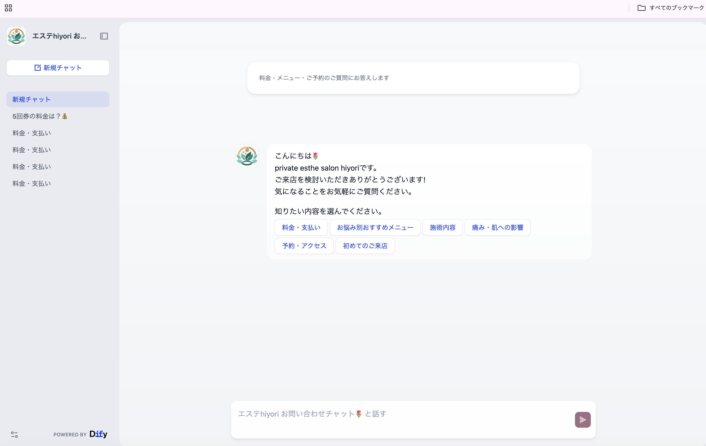
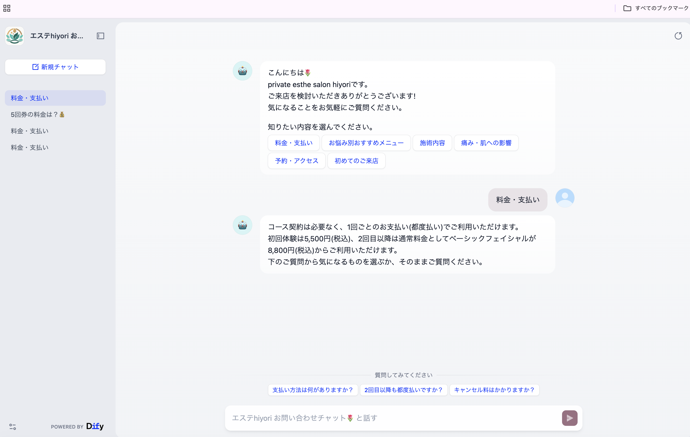
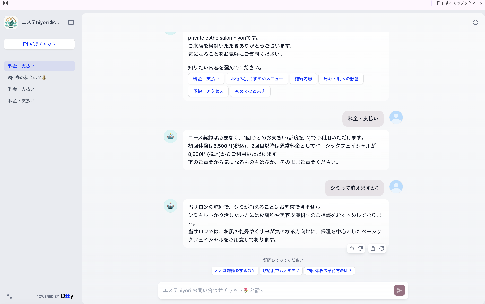
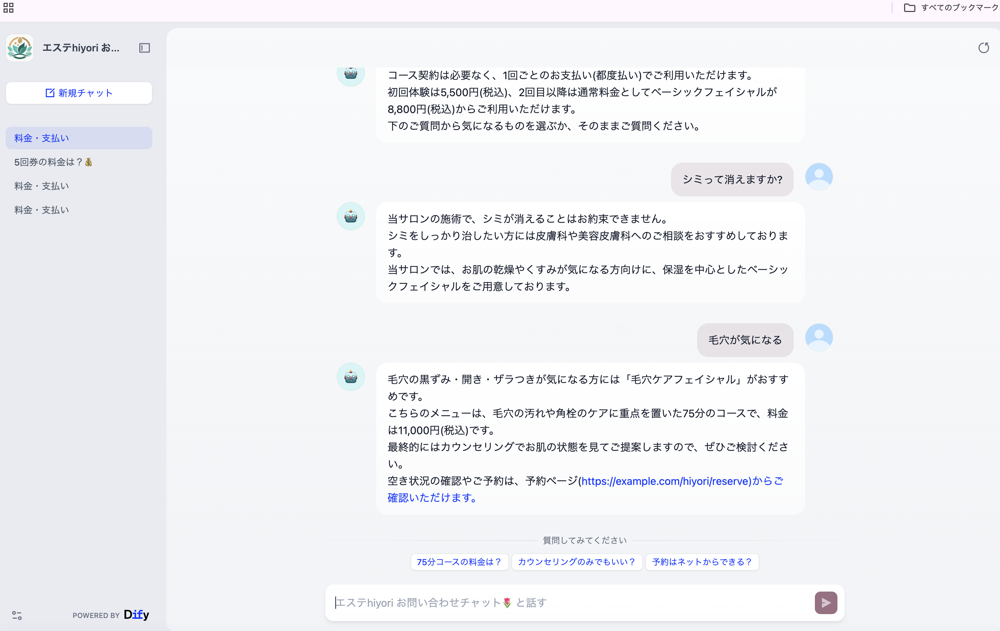

# hiyori-esthe-chatbot

エステサロンの「予約前の質問」に 24 時間答える、Dify 製のチャットボットです。
架空のフェイシャルエステサロン「private esthe salon hiyori」を題材にした、Web デザイナーのりほが制作したポートフォリオ作品です。

**デモURL:** https://udify.app/chat/a8kDznLlJq3tvNCC

- 担当:企画・要件定義・ナレッジ作成・プロンプト設計・テスト・改善(一人で担当、制作期間:1日)
- ※無料枠で動かしているため、利用が集中すると一時的に答えられない場合があります

## このボットについて

### 解決したい課題

個人で営業するエステサロンは、施術中に DM や電話に出られません。
初めて来店する人には「痛くない?」「勧誘されない?」「料金はいくら?」といった予約前の不安があり、聞けないまま予約をやめてしまうことがあります。

### サロンに導入するメリット

- 施術中や営業時間外も、24時間お客様の質問に答えられる
- 初めての方の不安(料金・痛み・勧誘)を、予約前に解消できる
- よくある質問への個別対応の時間を減らせる

### このボットでできること

単なる FAQ ではなく、次の 3 つを目的にしています。

1. **予約前の不安を解消する**(料金・痛み・勧誘・敏感肌など)
2. **お悩みに合うメニューを提案する**(毛穴・乾燥・むくみなど)
3. **予約ページへつなげる**(予約ページと LINE の URL を案内)

| 機能 | 内容 |
| --- | --- |
| よくある質問への回答 | ナレッジ(約 40 項目)をもとに、料金・施術内容・予約方法などに答える |
| カテゴリボタン | 6 カテゴリから選ぶだけで質問を始められる |
| 次の質問ボタン | 回答のあとに、次に聞きそうな質問を 3 つ表示する |
| お悩み別のメニュー提案 | お悩みを聞いて、メニューを 1 つ提案する |
| 答えられない質問の案内 | ナレッジにないことは推測せず、LINE へ案内する |

### 使っているもの(費用 0 円)

| 項目 | 内容 |
| --- | --- |
| 開発ツール | Dify Cloud(Sandbox プラン・無料) |
| AI モデル | Gemini 3.5 Flash-Lite(無料枠) |
| 検索 | ナレッジ検索(ベクトル検索、埋め込みモデル gemini-embedding-001) |
| アプリの種類 | チャットボット(ワークフローは使わないシンプルな構成) |

## スクショ

### 1. 開始画面とカテゴリボタン

開いた瞬間に、6つのカテゴリボタンから質問を始められます。



### 2. カテゴリの紹介と、次の質問ボタン

「料金・支払い」を押すと、初回体験と2回目以降の料金を短く紹介します。画面下には、次に聞きそうな質問が3つ表示されます。



### 3. 効果を言い切らない回答

「シミって消えますか?」という質問には、消えるとは言い切らず、皮膚科への相談をすすめたうえで、サロンで受けられるケアを案内します。



### 4. お悩みに合うメニュー提案と予約への案内

「毛穴が気になる」と伝えると、毛穴ケアフェイシャルを料金・時間つきで提案し、予約ページへ案内します。



## 工夫したこと

### 効果を言い切らない(薬機法・景品表示法への配慮)

エステの広告では「必ず」「シミが消える」「若返る」といった言い切りが問題になります。
指示文(プロンプト)で、これらの表現を禁止しました。効果を聞かれたときは「感じ方には個人差があります」と伝え、カウンセリングへ案内します。また、肌の症状の診断はせず、心配な方には皮膚科への相談をすすめます。

### ナレッジにないことは推測しない

回答はナレッジの内容だけをもとにします。載っていない質問には、決まった文で LINE へ案内します。
決まった文にしておくと、公開後にログから「答えられなかった質問」を探しやすくなり、ナレッジを足して育てていけます。

### 読みやすい短い回答

回答は 2〜4 文を目安にし、結論から答えます。料金は金額のあとに「(税込)」を付けて、誤解が起きないようにしました。

### 迷わない画面設計

開いた瞬間に「何を聞けばいいか」がわかるよう、6 つのカテゴリボタンを用意しました。
ボタンを押すとカテゴリを短く紹介し、続けて次の質問ボタンが 3 つ表示されます。文字入力が苦手な人でも、タップだけで質問できます。

### 言い換えに強い検索

お客様が、ナレッジと同じ言葉で質問してくれるとは限りません(例:「すっぴんで行っていい?」)。
そのため、言い換えに強い「高品質」インデックス(ベクトル検索)を選びました。

## テストと改善の過程

公開前にプレビュー画面で質問を試し、うまくいかなかった点を直しました。

### 1. 番号で選ぶ方式では答えられなかった

- **問題:** 最初は番号で選ぶ方式にしていました。しかし、検索は最新のメッセージだけで行われるため、「1」だけが送られても何を指すのか分からず、答えられませんでした。
- **改善:** 番号をやめ、**カテゴリ名のボタン**と、**フォローアップ(次の質問)ボタン**で質問できる方式に変更しました。質問が言葉で送られるので、正しく検索できます。

### 2. 回答の前置きが長かった

- **問題:** 「ようこそ!」「〜気になりますよね」といった挨拶や共感の言葉が長く、知りたい答えまでが遠く感じられました。
- **改善:** プロンプトに「結論から答える。挨拶や共感の前置きは書かない」と追加し、答えをすぐ読めるようにしました。

### 3. 2 回目以降の料金や 5 回券の料金に答えられなかった

- **問題:** 「2 回目以降はいくら?」「5 回券はいくら?」と聞くと、答えられませんでした。ナレッジに具体的な金額の項目がなかったためです。
- **改善:** ナレッジに、2 回目以降の料金と 5 回券の料金の項目を追加しました。これで具体的な金額を答えられるようにしました。

## 今後の課題

- **フォローアップが、ナレッジにない質問を出すことがあります。** 次の質問ボタンは AI が予測して作るため、答えられない話題が出ることがあります。
- **標準画面では、質問ボタンが小さいです。** スマホでは押しにくい場合があります。
- 上の 2 点は、Dify の標準画面の制約によるものです。**チャットフローの利用や、自作のチャット画面**での改善を検討しています。
- サロンの HP に埋め込み、実際の使い心地を確認する。
- 公開後はログを見て、答えられなかった質問をナレッジに追加していく。

## フォルダ構成

```
.
├── docs/
│   └── requirements.md      要件定義書
├── knowledge/
│   └── esthe_faq.md         ナレッジ(よくある質問)
├── prompt/
│   ├── system_prompt.md     ボットの指示文
│   └── followup_prompt.md   次の質問ボタン用の指示文
├── dify/
│   └── hiyori-chatbot.ifpkg Dify のエクスポートファイル
└── images/                  スクショ画像
```

### ファイル一覧

| ファイル | 内容 |
| --- | --- |
| [docs/requirements.md](docs/requirements.md) | 要件定義書 |
| [knowledge/esthe_faq.md](knowledge/esthe_faq.md) | ナレッジ(よくある質問) |
| [prompt/system_prompt.md](prompt/system_prompt.md) | ボットの指示文 |
| [prompt/followup_prompt.md](prompt/followup_prompt.md) | 次の質問ボタン用の指示文 |
| [dify/hiyori-chatbot.ifpkg](dify/hiyori-chatbot.ifpkg) | Dify のエクスポートファイル |
| [images/](images/) | スクショ画像 |

Dify のエクスポートファイルは、Dify の「アプリを DSL からインポート」から読み込めます。
ナレッジは含まれないため、`knowledge/esthe_faq.md` を別途アップロードしてください。

## 導入の流れ

このチャットボットは、個人事業主のホームページに設置することを想定しています。サロン以外の業種にも対応できます。

1. **ヒアリング:** よくある質問、料金、メニュー、予約方法などをお聞きします
2. **ナレッジ作成:** お店の情報を、チャットボットが答えられる形にまとめます
3. **テスト・調整:** 実際の質問で試し、回答の言い回しや表現を調整します
4. **ホームページへの設置:** ホームページの右下などにチャットボタンを設置します(ホームページの編集権限が必要です)
5. **運用・改善:** 答えられなかった質問を確認し、ナレッジを追加していきます

ホームページ制作とあわせてのご依頼にも対応しています。

## ご注意

- 店名・住所・料金・URL はすべて**架空**です(予約ページと LINE の URL は仮のものです)。
- API キーなどの秘密情報は含まれていません。
